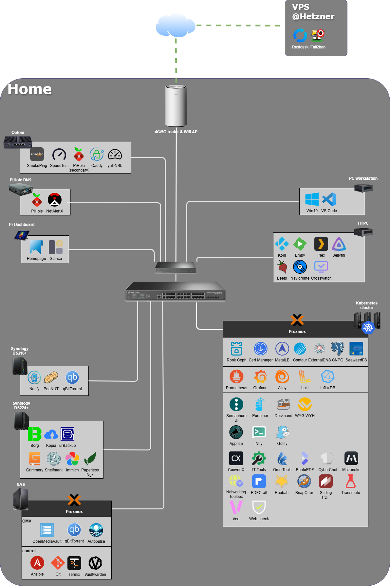

# Homelab by Zoltan Kutasi

This repository is the home of my homelab and various scripts and tool configs for it.
Separate README files are placed in each selected folder to further emphasize how the specific component can be used.

## Overview

All of this is a work in progress. The hardware is more or less final,
but the Infrastructure as Code aspects will evolve as well as the hosted Services will grow.

### Hardware

- 1x Digitus DN-19 16U-6/6-SW Rack & a bunch of extra stuff for it
- 1x TP-Link TL-SG3428X 24 Port Gigabit Switch + 4 Port SFP+
- 1x TP-Link TL-SG2008P JetStream 8 Port Gigabit Smart Switch PoE
- 3x Dell Optiplex Micro 7060 with i5-8500T, 32GB RAM, 256GB SSD + 1TB SSD
- 1x Synology 216+II with 2x6TB HDD
- 1x Synology 224+ with 2x12TB HDD
- 2x Raspberry Pi 4 32GB SD
- 1x Eaton Ellipse PRO 1600 DIN 1600VA UPS
- 1x External VPS with 1 vCPU and 512MB RAM
- 1x Intel NUC Kit 7i3DNHE with i3-7100U, 16GB RAM, 500GB SSD
- 1x Intel NUC Kit 7i3BNH with i3-7100U, 8GB RAM, 256GB SSD
- 1x Qotom mini PC appliance with 4x 1Gbps Ethernet ports
- 1x Self-built tower PC
  - Motherboard: Supermicro X11SSH-F
  - CPU: Intel Pentium G4560
  - RAM: 32GB
  - Storage: 256GB SSD + 8x 8TB HDD

And a bunch of smaller stuff.

They consist of:

- 3x Dell Optiplex as a Proxmox cluster, hosting a Kubernetes cluster in 3 controller + 3 worker VMs
- 1x Synology NAS for Music
- 1x Synology NAS for Documents, Photos and work related stuff
- 1x Raspberry Pi 4 for Pi-hole DNS
- 1x Raspberry Pi 4 for a Dashboard screen
- 1x Qotom small appliance machine with 4x1Gbps Ethernet ports
- 1x VPS for essential things to host remotely (RustDesk for example)
- 1x NUC for HTPC purposes
- 1x NUC for private stuff (Windows)
- 1x Self-built tower PC for NAS with Movies, TVShows and co.

### Tech stacks

#### General tools

These are fundamental or general tools I built my infrastructure on or use it across the whole homelab.

| Logo | Name | Description |
|------|------|-------------|
|  | [Docker](https://www.docker.com/) | Docker is an open platform for developing, shipping, and running applications. |
|  | [Proxmox](https://www.proxmox.com) | Proxmox Virtual Environment is a complete open-source platform for enterprise virtualization. With the built-in web interface you can easily manage VMs and containers, software-defined storage and networking, high-availability clustering, and multiple out-of-the-box tools using a single solution. |
|  | [Ubuntu Server](https://ubuntu.com/server) | Base OS for anything requiring one |

#### Automation & GitOps stack

Automating the setup of the hosts and apps, keeping the versions up-to-date and reconciling what is deployed.

| Logo | Name | Description |
|------|------|-------------|
|  | [Ansible](https://www.ansible.com) | Ansible is a radically simple IT automation platform that makes your applications and systems easier to deploy and maintain. Automate everything from code deployment to network configuration to cloud management, in a language that approaches plain English, using SSH, with no agents to install on remote systems. |
|  | [Terraform](https://developer.hashicorp.com/terraform) | Terraform enables you to safely and predictably create, change, and improve infrastructure. It is a source-available tool that codifies APIs into declarative configuration files that can be shared amongst team members, treated as code, edited, reviewed, and versioned. |
|  | [Renovate](https://www.mend.io/renovate/) | Cross-platform Dependency Automation by Mend.io |
|  | [Flux](https://fluxcd.io/) | Open and extensible continuous delivery solution for Kubernetes. Powered by GitOps Toolkit. |
|  | [Semaphore UI](https://semaphoreui.com/) | Modern UI and powerful API for Ansible, Terraform/OpenTofu/Terragrunt, PowerShell and other DevOps tools. |

#### Networking stack

| Logo | Name | Description |
|------|------|-------------|
|  | [Pi-hole](https://pi-hole.net/) | A black hole for Internet advertisements |
|  | [Unbound](https://www.nlnetlabs.nl/projects/unbound/about/) | Used with Pi-hole, to bypass public DNS Servers |
|| [Nebula-sync](https://github.com/lovelaze/nebula-sync) | Synchronize configuration of multiple Pi-hole v6.x instances. |
|  | [Caddy](https://github.com/caddyserver/caddy) | Fast and extensible multi-platform HTTP/1-2-3 web server with automatic HTTPS |

#### Backups stack

| Logo | Name | Description |
|------|------|-------------|
|  | [Borgmatic](https://torsion.org/borgmatic/) | Simple, configuration-driven backup software for servers and workstations |
|  | [Borgwarehouse](https://borgwarehouse.com/) | A fast and modern WebUI for a BorgBackup's central repository server. |
|  | [Kopia](https://kopia.io/) | Cross-platform backup tool for Windows, macOS & Linux with fast, incremental backups, client-side end-to-end encryption, compression and data deduplication. CLI and GUI included. |
|  | [UrBackup](https://www.urbackup.org/) | UrBackup is an easy to setup Open Source client/server backup system, that through a combination of image and file backups accomplishes both data safety and a fast restoration time. |
|  | [Portabase](https://portabase.io/) | Database backup & restore tool for PostgreSQL, MySQL, MsSQL, MariaDB, Firebird SQL, SQLite, MongoDB, Redis, Files and Docker Volume |
|  | [Databasus](https://databasus.com/) | PostgreSQL backup tool with Point-In-Time-Recovery and restore verification |

#### Kubernetes infrastructure stack

| Logo | Name | Description |
|------|------|-------------|
|  | [Kubernetes](https://kubernetes.io/) | Orchestrate containerized applications |
|  | [Helm](https://helm.sh/) | A package manager for Kubernetes |
|  | [Rook Ceph](https://rook.io) | Storage Orchestration for Kubernetes |
|  | [MetalLB](https://metallb.io/) | A network load-balancer implementation for Kubernetes using standard routing protocols |
|  | [Cert Manager](https://cert-manager.io/) | Automatically provision and manage TLS certificates in Kubernetes |
|  | [Contour](https://projectcontour.io/) | Contour is a Kubernetes ingress controller using Envoy proxy. |
|  | [ExternalDNS](https://github.com/kubernetes-sigs/external-dns) | Configure external DNS servers dynamically from Kubernetes resources |
|  | [CloudNativePG](https://cloudnative-pg.io/) | The open-source platform designed to seamlessly manage the entire operational lifecycle of PostgreSQL databases within Kubernetes |
|  | [SeaweedFS](https://seaweedfs.com/) | SeaweedFS is a distributed storage system for object storage (S3), file systems, and Iceberg tables, designed to handle billions of files with O(1) disk access and effortless horizontal scaling. |

#### Media stack

Manage my Movies, Music, Books, Photos and all media files.

| Logo | Name | Description |
|------|------|-------------|
|  | [OpenMediaVault](https://www.openmediavault.org/) | openmediavault is the next generation network attached storage (NAS) solution based on Debian Linux. It contains services like SSH, (S)FTP, SMB/CIFS, DAAP media server, RSync, Kubernetes and many more ready to use. |
|  | [Emby](https://emby.media/) | Bringing all of your home videos, music, and photos together into one place has never been easier. Your personal Emby Server automatically converts and streams your media on-the-fly to play on any device. |
|  | [Kodi](https://kodi.tv/) | Kodi is an award-winning free and open source home theater/media center software and entertainment hub for digital media. With its beautiful interface and powerful skinning engine, it's available for Android, BSD, Linux, macOS, iOS, tvOS and Windows. |
|  | [Plex](https://www.plex.tv/) | Don’t just store your movies and music—experience it like never before. Plex personal media server magically scans and organizes your files, sorting your media intuitively and beautifully. |
|  | [Jellyfin](https://jellyfin.org/) | The Free Software Media System - Server Backend & API |
|  | [Crosswatch](https://github.com/cenodude/CrossWatch) | Synchronize your data across media servers, media agents and trackers. Keep your movies and shows in sync, no matter where you watch. |
|  | [Autopulse](https://autopulse.dancodes.online/autopulse/) | automated lightweight service that updates media servers like Plex and Jellyfin based on notifications from media organizers like Sonarr and Radarr |
|  | [Beets](https://beets.io/) | music library manager and MusicBrainz tagger |
|  | [Grimmory](https://grimmory.org/) | A self-hosted library for your ebooks, comics, and audiobooks. Grimmory is an independent community fork of [BookLore](https://github.com/booklore-app/booklore). |
|  | [Shelfmark](https://github.com/calibrain/shelfmark) | Shelfmark is a self-hosted web interface for searching and requesting books and audiobooks across multiple sources. |
|  | [Immich](https://immich.app/) | High performance self-hosted photo and video management solution. |
|  | [Navidrome](https://www.navidrome.org/) | An open source web-based music collection server and streamer. It gives you freedom to listen to your music collection from any browser or mobile device. It's like your personal Spotify! |
|  | [Paperless-NGX](https://docs.paperless-ngx.com/) | A community-supported supercharged document management system: scan, index and archive all your documents |

#### Monitoring stack

| Logo | Name | Description |
|------|------|-------------|
|  | [Alloy](https://grafana.com/docs/alloy/latest/) | Grafana Alloy combines the strengths of the leading collectors into one place. Whether observing applications, infrastructure, or both, Grafana Alloy can collect, process, and export telemetry signals to scale and future-proof your observability approach. |
|  | [Prometheus](https://prometheus.io) | The Prometheus monitoring system and time series database. |
|  | [Loki](https://grafana.com/oss/loki/) | Loki is a horizontally scalable, highly available, multi-tenant log aggregation system inspired by Prometheus. It is designed to be very cost effective and easy to operate. It does not index the contents of the logs, but rather a set of labels for each log stream. |
|  | [Grafana](https://grafana.com) | Grafana Open Source Software (OSS) enables you to query, visualize, alert on, and explore your metrics, logs, and traces wherever they’re stored. Grafana data source plugins enable you to query data sources including time series databases like Prometheus and CloudWatch, logging tools like Loki and Elasticsearch, NoSQL/SQL databases like Postgres, CI/CD tooling like GitHub, and many more. Grafana OSS provides you with tools to display that data on live dashboards with insightful graphs and visualizations. |
|  | [InfluxDB](https://www.influxdata.com/) | Scalable datastore for metrics, events, and real-time analytics |
|  | [Beszel](https://beszel.dev/) | Lightweight server monitoring with historical data, docker stats, and alerts. |
|  | [Gatus](https://gatus.io/) | Automated developer-oriented status page with alerting and incident support |
|  | [PatchMon](https://patchmon.net/) | Linux Patch Management & Automation Platform |
|  | [Network UPS Tools](https://networkupstools.org/) | The primary goal of the Network UPS Tools (NUT) project is to provide support for Power Devices, such as Uninterruptible Power Supplies, Power Distribution Units, Automatic Transfer Switches, Power Supply Units and Solar Controllers. NUT provides a common protocol and set of tools to monitor and manage such devices, and to consistently name equivalent features and data points, across a vast range of vendor-specific protocols and connection media types. |
|  | [Nutify](https://github.com/DartSteven/Nutify) | Modern web-based UPS monitoring system with real-time data visualization, alerts, and comprehensive reporting. Docker-ready with multi-architecture support. |
|  | [PeaNUT](https://github.com/Brandawg93/PeaNUT) | A tiny dashboard for Network UPS Tools |
|  | [Speedtest tracker](https://github.com/alexjustesen/speedtest-tracker) | Speedtest Tracker is a self-hosted application that monitors the performance and uptime of your internet connection. |
|  | [SmokePing](https://oss.oetiker.ch/smokeping/) | SmokePing is a deluxe latency measurement tool. It can measure, store and display latency, latency distribution and packet loss. SmokePing uses RRDtool to maintain a longterm data-store and to draw pretty graphs, giving up to the minute information on the state of each network connection. |
|  | [YaDNSb](https://github.com/butialabs/yadnsb) | A DNS performance testing IPv4, IPv6, DNS over HTTPS (DoH), DNS over TLS (DoT), and DNS over QUIC (DoQ). |
|| [Arpwatch](https://www.kali.org/tools/arpwatch/) | Arpwatch maintains a database of Ethernet MAC addresses seen on the network, with their associated IP pairs. Alerts the system administrator via e-mail if any change happens, such as new station/activity, flip-flops, changed and reused old addresses. |
|  | [NetAlertX](https://netalertx.com/) | Centralized network visibility and continuous asset discovery. Monitor devices, detect change, and stay aware across distributed networks. |
|  | [Glances](https://github.com/nicolargo/glances) | Glances an Eye on your system. A top/htop alternative for GNU/Linux, BSD, macOS and Windows operating systems. |

#### Notifications stack

Everything goes through Apprise and fan out into the push services. Every notification/email worth it becomes a push event. Or an Alert in Prometheus/Alertmanager.

| Logo | Name | Description |
|------|------|-------------|
|  | [Apprise](https://appriseit.com/) | Push Notifications that work with just about every platform! |
|  | [Pushover](https://pushover.net/) | Pushover makes it easy to get real-time notifications on your Android, iPhone, iPad, and Desktop (Android Wear and Apple Watch, too!) |
|  | [Ntfy](https://ntfy.sh/) | Send push notifications to your phone or desktop using PUT/POST |
|  | [Gotify](https://gotify.net/) | A simple server for sending and receiving messages in real-time per WebSocket. (Includes a sleek web-ui) |
|| [Mailrise](https://mailrise.xyz/) | An SMTP gateway for Apprise notifications. |
|  | [Alertmanager](https://prometheus.io/docs/alerting/latest/alertmanager/) | Handles alerts sent by client applications such as the Prometheus server. It takes care of deduplicating, grouping, and routing them to the correct receiver integration such as email, PagerDuty, or OpsGenie. It also takes care of silencing and inhibition of alerts. |

#### Management stack

These are services that allow me to manage certain aspects of the infrastructure, being containers, remote desktop, SSH, network or any hardware, like a UPS.

| Logo | Name | Description |
|------|------|-------------|
|  | [DockHand](https://dockhand.pro) | Docker management you will like. |
|  | [Portainer](https://www.portainer.io/) | Making Docker and Kubernetes management easy. |
|  | [RustDesk](https://rustdesk.com/) | An open-source remote desktop application designed for self-hosting, as an alternative to TeamViewer. |
|  | [Termix](https://docs.termix.site/) | Self-hosted SSH and remote desktop management. |

#### Security stack

Protecting the hosts, scanning for vulnerabilities, and keeping secrets and passwords safe.

| Logo | Name | Description |
|------|------|-------------|
|  | [Wazuh](https://wazuh.com/) | The Open Source Security Platform. Unified XDR and SIEM protection for endpoints and cloud workloads. |
|  | [OpenVAS](https://www.openvas.org/) | A full-featured vulnerability scanner. Its capabilities include unauthenticated and authenticated testing, various high-level and low-level internet and industrial protocols, performance tuning for large-scale scans and a powerful internal programming language to implement any type of vulnerability test. |
|  | [Fail2Ban](https://github.com/fail2ban/fail2ban) | Daemon to ban hosts that cause multiple authentication errors |
|  | [Vaultwarden](https://github.com/dani-garcia/vaultwarden) | Unofficial Bitwarden compatible server written in Rust, formerly known as bitwarden_rs |
|| [SOPS](https://getsops.io/) & [age](https://github.com/FiloSottile/age) | Encrypting secrets so they can still be committed and version-controlled in git |

#### Others

| Logo | Name | Description |
|------|------|-------------|
|  | [Homepage](https://gethomepage.dev/) | A highly customizable homepage (or startpage / application dashboard) with Docker and service API integrations. |
|  | [Glance](https://github.com/glanceapp/glance) | A self-hosted dashboard that puts all your feeds in one place |
|  | [WYGIWYH](https://github.com/eitchtee/WYGIWYH) | A simple but powerful self-hosted finance tracker |
|  | [ConvertX](https://github.com/C4illin/ConvertX) | Self-hosted online file converter. Supports 1000+ formats |
|  | [IT Tools](https://github.com/CorentinTh/it-tools) | Collection of handy online tools for developers, with great UX. |
|  | [Omni Tools](https://github.com/iib0011/omni-tools) | Self-hosted collection of powerful web-based tools for everyday tasks. No ads, no tracking, just fast, accessible utilities right from your browser! |
|  | [BentoPDF](https://www.bentopdf.com) | The Privacy First PDF Toolkit |
|  | [Cyberchef](https://github.com/gchq/CyberChef) | The Cyber Swiss Army Knife - a web app for encryption, encoding, compression and data analysis |
|  | [Mazanoke](https://mazanoke.com/) | A self-hosted local image optimizer that runs in your browser |
|  | [Networking Toolbox](https://github.com/lissy93/networking-toolbox) | 100+ offline-first networking tools and utilities |
|  | [PDFCraft](https://pdfcraft.devtoolcafe.com/) | A free, privacy-focused PDF toolkit that runs entirely in your browser. With 90+ professional tools, you can edit, convert, merge, split, and secure your PDF files without ever uploading them to a server. |
|  | [Reubah](https://github.com/dendianugerah/reubah) | a web-based tool for processing images and converting documents with a simple interface |
|  | [SnapOtter](https://snapotter.com/) | Open-source, self-hosted file-processing tool. Convert, compress, OCR, transcribe & run local AI across image, video, audio, PDF & documents, via UI, REST API & pipelines. Your files never leave your network. |
|  | [Stirling PDF](https://www.stirlingpdf.com/) | No1 PDF Application on GitHub that lets you edit PDFs on any device anywhere |
|  | [Transmute](https://transmute.sh/) | Self hosted file converter and compression tool for images, video, audio, json, excel and more. Supports over 3,000 conversions! |
|  | [Vert](https://vert.sh/) | The next-generation file converter. Open source, fully local* and free forever. |
|  | [Web-Check](https://web-check.xyz/) | All-in-one OSINT tool for analysing any website |

### Development

I am using VS Code, with a few plugins and tricks:

- Remote SSH - Writing code on my Windows PC, but using it to enter into a Linux host that has a few things installed (Git, Ansible, Terraform, Kubernetes toolings, etc...)
- Drawing pictures with Draw.io
- GitHub Copilot - To help me with some code completion and writing faster
- Vscode-sops - Encrypting secrets in the repository with [SOPS](https://github.com/getsops/sops) and [age](https://github.com/FiloSottile/age)
- Support for Jinja, Python, Ansible and any languages required
- Run Terminal Command - A simple extension to allow me to run arbitrary commands by right clicking on files in the Explorer window.

### Repository layout and conventions

How this repository is organised and the conventions every App follows. Follow these when adding or changing anything; when a change needs to break one, decide it explicitly instead of drifting.

#### Folder structure

- The top-level folders are categories (monitoring, media, backups, etc...), sometimes with sub-categories. Their README describes the requirements and the investigated contenders for that kind of App.
- Each App has its own folder below its category, with a README describing the setup, the inventory variables, the deployment and any notable comments.
- Apps with more than one component split them into sub-folders: `central` for the main component and `agents` for what runs on the other hosts, or `k8s`, `docker` and `host` when the same App can be deployed in multiple ways.
- Shared helpers live in the repository root as `common-*.sh`, reusable Ansible roles in `automation/ansible/roles`, the scaffolding for new Apps in `_templates`, and the tests in `tests`.

#### File naming

- Playbooks of an App: `deploy-<app>.yaml`, `undeploy-<app>.yaml`, `configure-<app>.yaml` and `generate-configuration.yaml`; host setup playbooks: `setup-<topic>.yaml`.
- Task files that are only included by another playbook: `tasks-<topic>.yaml`. They are never run on their own.
- Kubernetes scripts: `deploy-k8s.sh` and `undeploy-k8s.sh`.
- YAML files use the `.yaml` extension. Jinja templates end in `.j2` and live under the App's `config/templates/`, static files under `config/static/`.

#### Where commands run

- Ansible playbooks are executed from the repository root through the `common-ansible-run-playbook.sh` wrapper, passing the playbook path relative to the root. It runs in check and diff mode by default, so nothing changes until `--no-check` is added.
- Kubernetes deployment scripts (`deploy-k8s.sh` and `undeploy-k8s.sh`) are executed from the folder containing the script, as they pick up the files lying next to them.
- Scripts never change their own working directory; paths relative to the caller's directory are deliberate. Where a script needs the repository root, it builds the path from `git rev-parse --show-toplevel`.

#### Prerequisites on the control host

- Ansible runs inside a locally built execution environment (a container image with Ansible and all required collections), built once with `automation/ansible/deploy-ansible.sh`.
- The Ansible inventory lives in a separate private git repository, cloned into `automation/ansible/homelab-ansible-inventory`. It is ignored by this repository, so no host details or passwords end up here.
- The scripts call a few command-line tools directly: `kubectl`, `helm`, `kompose`, `kustomize`, `sops`, `age`, `curl`, `jq` and the Go-based `yq` (mikefarah/yq v4; the Python `yq` wrapper of the same name doesn't work).
- The repository's own playbooks install them:
  - `basics/setup-packages.yaml`;
  - the `kubernetes/tools` playbooks;
  - the ones in `security/secret-mgmt/age-sops`.

#### Shell scripts

- Shebang `#!/bin/bash`, and the file is executable.
- No strict mode (`set -e`, `set -euo pipefail`); where a failure would go unnoticed, a targeted check is added on that one command instead. Every `cd`, `pushd` and `popd` carries its own `|| exit 1` (shellcheck SC2164).
- Variables in `UPPER_CASE`, referenced as `"${VAR}"`, except very short ones that can't hold a space (like `NS`), which are written bare as `$NS`, except inside array assignments (`CMD=(… "$NS")`), where shellcheck needs them quoted. Messages start with `ERROR:`, `WARNING:` or `INFO:`.
- Every script, App wrappers included, parses its arguments in a `while [ $# -ge 1 ]; do case "$1" in … esac; shift; done` loop, even when it only passes them on, so all scripts look alike and options can be added later. The common scripts reject unknown parameters with an error plus the usage, and offer `--help`.
- App wrappers stay thin:
  - they set `NS`, `RELEASE_NAME`, `CHART_NAME`, `VERSION` etc.;
  - they collect their arguments in that loop into the `EXTRA_PARAMS` array (after any fixed options of their own, like `EXTRA_PARAMS=(--delete-namespace 0)`) and pass them on as `"${EXTRA_PARAMS[@]}"`;
  - they call the matching helper through `"$(git rev-parse --show-toplevel)"/common-<x>.sh`.
- A tool is written in one language: Bash, with `yq` and `jq` for any YAML or JSON work, never mixed with Python helpers. Ansible playbooks it runs stay separate files.

#### Ansible

- Modules by fully qualified name (`ansible.builtin.copy`, `community.docker.docker_compose_v2`, …), and file modes as quoted strings (`mode: "0644"`).
- `ansible.cfg` sets `jinja2_native = True`: whenever a whole `{{ … }}` value could look like a number (versions, tags, IDs), the filter chain ends with `| string`, otherwise it is silently turned into an int or float.
- Privileged tasks inside roles set their own `become: true`, handlers included.
- Anything that talks to Docker uses the host's settings, like the shared role does: `become: "{{ docker_with_sudo }}"` and `docker_cli: "{{ docker_cli_path }}"`, with App folders under `{{ docker_compose_rootdir }}`, never a hardcoded path.
- Plays target inventory groups named after a role, never single host names; host-specific template and script folders are named after the host.
- Playbooks work in check mode: read-only lookups run with `check_mode: false`, and later tasks tolerate what a skipped write would have created.
- Services are restarted through handlers on actual changes, not unconditionally.
- An undeploy removes everything the deploy and its configure playbooks created, and can be re-run without failing.

#### Templates, private files and secrets

- Anything that depends on the inventory (passwords, hostnames, IPs, domains) is never written directly: a `generate-configuration.yaml` playbook renders the `config/templates/**/*.j2` templates into `*-private.yaml` files. Every file with `private` in its name is ignored by git (except templates and `_encrypted` copies) and encrypted by `sops.sh --encrypt-all`.
- When such a private file has to be kept in the repository, its SOPS-encrypted copy is committed with the `_encrypted` suffix. A pre-commit hook makes sure the encrypted copies are up-to-date with the decrypted ones.
- Loops in templates that produce files are sorted (``, and `| sort` after `difference`, `union`, `intersect` and `symmetric_difference`), so the generated files stay stable between runs.
- A `ca.key` may only be committed as a symlink to the SOPS-managed key.
- `sops.sh` encrypts in binary mode with a single age key, passed on the command line; a `.sops.yaml` only comes with a second recipient, such as a backup key. `--redecrypt-all` deliberately recreates every plaintext from its `_encrypted` copy, overwriting local changes.
- Secrets may show up in Ansible output and logs (no `no_log`), as long as those logs are ephemeral or kept out of git, like the ansible-navigator debug log under `/tmp`. A secret must never land in git or another shared place.

#### Docker Apps

- Each App has a `docker-compose.yaml.j2` template, filled in from the Ansible inventory, plus a `deploy-<app>.yaml` and `undeploy-<app>.yaml` playbook.
- The deploy playbook pins the image versions and lists the folders and config files to create. A shared Ansible role renders everything into its own folder per App under `docker_compose_rootdir` (usually `~/docker-compose`) on the target host and starts the stack.
- Each service:
  - sets `container_name`, `hostname: {{ id }}-<container_name>`, `restart: unless-stopped` (`restart: no` for services that run once and exit, like setup or check helpers) and `TZ: {{ timezone }}` (plus `PUID`/`PGID` where the image supports them);
  - takes its image from an entry of the deploy playbook's `requested_image_version`;
  - mounts its folders from below `{{ docker_compose_rootdir }}/{{ docker_compose_projectname }}`.
- Undeploying an App runs `docker compose down` removing its volumes and images, then deletes its whole folder under `docker_compose_rootdir`, including all of its data and configuration. Back up anything worth keeping first.

#### Kubernetes Apps

- Each App has its own `deploy-k8s.sh` and `undeploy-k8s.sh`, which are thin wrappers around the shared `common-*.sh` scripts in the repository root (for Helm charts, Kustomize, Kompose, plain manifests and CloudNativePG databases).
- Run `deploy-k8s.sh` and `undeploy-k8s.sh` from the App's own folder, as they read their files relative to the current folder. They refuse to run anywhere else.
- Helm values are split into three files: `app-values.yaml` for the general settings, `app-values-dimensioning.yaml` for the resource requests, limits and storage sizes, and `app-values-private.yaml` for anything secret.
- Any additional raw manifest (ingress, certificates, scrape configs, alert rules, etc...) goes into the `extra-manifests` folder and is applied together with the App. The HTTPProxy and Certificate manifests are templates under `config/templates/extra-manifests/` using `{{ kubernetes_internal_domain }}`, never static files with a hardcoded domain.
- The uptime monitors and dashboards check each App by its HTTPProxy's root URL. Only an App whose main page can't be checked that way names another path in the `homelab/health-endpoint` HTTPProxy annotation; a dashboard that can't fall back to the root URL adds a status check only for those.
- Manifests never set `metadata.namespace`; the deploy helper supplies it with `-n $NS`. The only exception is where the API needs it inside the object, like a ClusterRoleBinding's ServiceAccount subject.
- Undeploying an App deletes its namespace, and with it every volume (PVC) and its data. Cluster-wide objects created by a Kustomize App are deleted explicitly before that. Apps sharing a namespace with others keep the namespace, and their StatefulSet volumes usually survive.
- What happens to a Helm App's CRDs on undeploy is up to its chart's defaults; the scripts never remove or keep CRDs by force. CRDs shipped in a chart's `crds/` folder or marked `helm.sh/resource-policy: keep` stay, the others are deleted on uninstall, together with every resource of their kind in the cluster.
- Manifests that were removed or renamed are cleaned up from the cluster by hand; the scripts don't prune.

#### Versions and Renovate

- Every version is pinned where Renovate can see it:
  - `requested_image_version` and `requested_binary_repo_version` in playbooks;
  - Galaxy requirements files;
  - `pkg==version` items in `pipx_packages` lists;
  - `package_pip: name==version` and `name==version` items of the `python:` list in execution environment files;
  - `CHART_NAME`, `REPO_URL` and `VERSION` in `deploy-k8s.sh`;
  - Helm values;
  - images in `extra-manifests/` (approved from the Dependency Dashboard);
  - a `# renovate: datasource=… depName=…` comment directly above a `VAR=version` line in shell scripts.
- A git commit is pinned the same way, with the branch it follows in the comment: `# renovate: datasource=git-refs depName=<repository URL> currentValue=<branch>` above a `VAR=<full commit hash>` line.
- Test images are the exception: they build `FROM` a plain tag and are tagged `:testing`, so they only change with their Dockerfile.
- Only direct dependencies are pinned. What they pull in themselves (Python packages below an execution environment's pins, a chart's subcharts, an image's packages) is resolved at build or install time and may move between builds; such a transitive dependency only gets a pin of its own once it breaks something, with the reason next to it.
- Renovate rules are generic (tag shape, datasource, file type), never specific to one App or image.
- Version bumps are left to Renovate.

#### Documentation

- Every App and category has a README following `_templates/README.layer1.md` (category) or `_templates/README.layer2.md` (App). The structure they give is fixed: chapter names and order, the numbered step sentences, and the tables and steps stay, even when empty. Only the content inside them is edited; information that doesn't fit goes into a row or a paragraph, or the template itself is changed for all READMEs.
- Inventory variable tables use `|Name|Mandatory/Optional|Details|`; Details describe what the value is, never which Apps or playbooks use it.
- A structured variable gets a row of its own, then one dotted row per field, where the field's M/O applies within its parent (`app_entries`, `app_entries.src`, ...). The keys of a dictionary are written as an escaped placeholder (`app_disks.\<label\>.role`), so that GitHub shows `<label>`. The structure is never described in the parent's Details.
- Each variable is documented once at the most generic level it belongs to:
  - user-specific, network-specific and host connection variables in the Ansible README;
  - Docker variables in the Docker README (per-App IPv6 subnets stay with their App);
  - variables shared by a group of Apps in that group's README;
  - App-specific variables, prefixed with the App's name, in every README of an App that uses them.
- Some documented variables are only read inside the private inventory, by other inventory values. They're documented like any other; a variable is only unused when neither the repository nor the inventory references it.
- READMEs never link to or name other READMEs for variables; the "Ansible inventory setup" chapter starts with the fixed generic sentence from the templates instead.
- Lists of playbooks describe what each one achieves conceptually, never its individual steps, files or hosts.
- A bullet holds one note:
  - a list of cases inside a note (modes, places, settings, steps) becomes sub-bullets under a short lead-in;
  - a topic with several notes gets its own sub-header, one level below its chapter, with one bullet per note.
- Commands are shown as run:
  - playbooks with their full path from the repository root through `./common-ansible-run-playbook.sh … --no-check`;
  - Kubernetes deploys as a bare `./deploy-k8s.sh`, run from the folder that holds it (the component's sub-folder for split Apps).
- Running a playbook stays an explicit README step, never hidden inside `deploy-k8s.sh`.

#### Tests

- `tests/run.sh` runs everything in containers:
  - the bats tests in `tests/bats` by default;
  - `--renovate` for the Renovate extraction check;
  - `--lint` for ansible-lint in the execution environment;
  - `--render` and `--render-k8s` for the render tests below;
  - `--molecule` for the role scenarios.
- Only Docker and the host's own static tools are needed: sops, age and yq, plus helm, kubectl, kustomize and kubeconform for `--render-k8s`, which also needs the network.
- Bats tests never touch hosts, the cluster or the real files: each test works in a throwaway copy of the scripts it needs (a temporary folder with an empty `.git` marker), with stub commands on `PATH` that record their calls. The `git` stub only answers `rev-parse --show-toplevel`.
- A script fix comes with a test that fails without it. A known bug can wait as a skipped test that names the reason.
- Tests never read a README: no test takes what to check or what to accept from README text or tables. A test may enforce a convention written here, but the rule lives in the test code, accepted exceptions go into an allowlist file with their reason, and per-App data a test needs lives in a data file of its own. Where documentation and test data have to agree, the documentation is generated from the data.
- A new or changed Renovate rule gets a fixture under `tests/renovate/fixtures`, and `tests/renovate/expected.tsv` lists exactly what Renovate must extract from them.
- Every test file names what it tests in `# covers:` header lines: paths or patterns from the repository root, where `*` also matches `/`. Keep them honest, as `tests/run.sh --changed <files>` (and its manual pre-commit hook) picks the tests by them:
  - it runs only the test files that cover the changed files;
  - a change to the harness itself runs all of them;
  - `wrappers.bats` checks only the changed wrappers.
- `tests/run.sh` alone still runs everything.
- The test suites don't run on commit, to keep commits fast; every change has to pass the suites it affects before it is done.
- They are pre-commit hooks in the manual stage:
  - the covering bats tests when shell files change;
  - the render tests for the Docker Apps and for the Kubernetes Apps whose files changed;
  - the Molecule scenarios of the changed roles and of the roles whose scenarios use them;
  - the Renovate check when `renovate.json` or its fixtures change;
  - ansible-lint (about 5 minutes).
- To run them:
  - `pre-commit run --hook-stage manual` for the staged files;
  - `pre-commit run --hook-stage manual --all-files` for everything;
  - `pre-commit run --hook-stage manual <hook id>` for one.
- shellcheck (warning level) still runs on every commit.

##### Docker render tests

- `tests/run.sh --render` renders every Docker App's compose file and config templates against a fake inventory in `tests/render/inventory`, for one host of its play, without contacting any host.
- Each compose file must pass `docker compose config` and the Docker App rules above.
- Accepted deviations go into `tests/render/allowlist.tsv` with their reason, Apps that need a specific host into `tests/render/skip.tsv`.
- The fake inventory has the real one's groups and variable names but dummy values and generic host names: rerun `tests/render/make-fake-inventory.sh` after inventory changes and review the result before committing.
- Values that a deploy playbook's earlier play fetches at run time get stand-ins in `tests/render/runtime.yaml`.

##### Kubernetes render tests

- `tests/run.sh --render-k8s` does the same for the Kubernetes Apps, with the same fake inventory, in a copy of each App's committed files. It renders, for the Kubernetes version Kubespray's `run-upgrade.sh` installs:
  - the templates of every `generate-configuration.yaml`;
  - each Helm or Kustomize App through its own `deploy-k8s.sh --template-output`.
- `kubeconform -strict` then validates the renders and every `extra-manifests` file, with the custom resources' schemas from the CRDs-catalog pinned to one commit.
- `tests/render/check-k8s-conventions.sh` checks the Kubernetes App rules above.
- Accepted deviations go into `tests/render/allowlist-k8s.tsv` with their reason, Apps the harness can't render into `tests/render/skip-k8s.tsv`.
- Symlinks to the internal CA become dummy files in the copy, so the real CA key is never read.
- Charts, the local charts' dependencies and the schemas are cached in `~/.cache/homelab-tests`; a full run takes about 75 seconds.

##### Molecule

- `tests/run.sh --molecule [<role>...]` runs every Molecule scenario of the given roles, or of all roles that have some: the `binary-*` and `package-*` roles today. A full run takes about 5 minutes.
- Molecule runs inside the execution environment, so tests and deploys share one ansible-core and one set of collections, and it drives the host's Docker through the mounted socket.
- Scenarios live in `automation/ansible/roles/<role>/molecule/<scenario>/`, Ansible-only (prepare, converge, verify). They share the base config `tests/molecule/config.yml`, which `-c` passes:
  - the targets;
  - the `docker_api` connection, as the execution environment has no docker CLI;
  - the roles path and pipelining;
  - lean create and destroy playbooks of its own (`tests/molecule/create.yml`, `destroy.yml`), as the driver's poll with a 5-second delay and run steps the tests don't use.
- Each scenario runs on one target, Ubuntu 24.04, the OS most hosts run, built from `tests/molecule/Dockerfile` as `homelab-molecule:testing`. It's rebuilt only when the Dockerfile changes, and the replaced image is removed.
- The targets boot systemd without `privileged`: they share the host's cgroup namespace with `/sys/fs/cgroup` mounted read-write, and tmpfs on `/run`, `/run/lock` and `/tmp`.
- Nothing is downloaded during a run: the prepare step builds fake binaries, archives and packages on each target and serves them on its localhost (`tests/molecule/*-fixtures.yml`), and the package scenarios remove the distribution's APT sources first.

#### Adding a new App

- `kickstart-app-project.sh` creates the folder of a new App from the `_templates` folder, for the chosen deployment type (binary, Docker Compose, or Kubernetes with Helm, Kustomize, Kompose or TrueCharts).
- It needs `curl`, `jq` and `yq` from the control host prerequisites.
- It can start from the upstream project's docker-compose file: it converts it into the matching templates, fills in the README links and the latest released version, and turns the sensitive environment variables into inventory variables.
- It does about 90% of the work; the rest is always finished by hand, and the end of the run lists every placeholder still to fill in. Re-running it over an existing App folder overwrites the generated files (it asks first, defaulting to yes), which is handy while working on the script itself.
- The `<UPPER_CASE>` markers in `_templates`, such as `<HELM_REPO_URL>`, are deliberate reminders of how a setting is written; they stay in the templates.

#### Repository-wide helper

- Some configurations depend on the list of all Apps: the reverse proxy, the local DNS entries, the dashboard and the uptime monitoring. Whenever an App is added or removed, run `update-homelab-config.sh` from the repository root, which regenerates and redeploys all of these in one go.

#### Linting

- Pre-commit hooks run on every commit: file hygiene (whitespace, line endings, large files, executable scripts), YAML and Markdown linting, two spell checkers, secret detection, the check that the SOPS-encrypted files are up-to-date, and the check that a `ca.key` is only committed as a symlink.
- The Ansible code can also be linted with `automation/ansible/ansible-lint.sh`.
